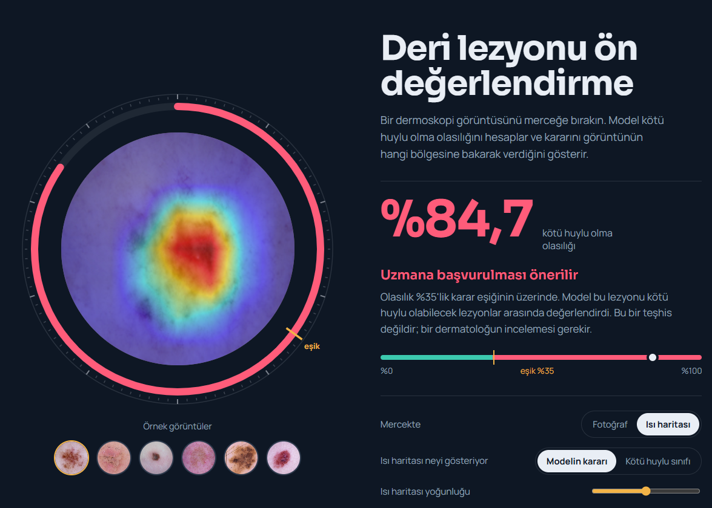

# Dermoskopi Görüntülerinden Transfer Öğrenme ile Deri Lezyonu Sınıflandırması

Dermoskopi görüntülerinden deri lezyonlarını **iyi huylu** ve **kötü huylu** olarak sınıflandıran, kararını Grad-CAM ısı haritasıyla açıklayan ve yerel bir web arayüzüyle kullanılabilen bir derin öğrenme sistemi.

> Bu sistem teşhis koymaz. Amacı, bir lezyonun uzmana gösterilmesi gerekip gerekmediğine dair ön değerlendirmeye destek olmaktır.

## Sonuçlar

HAM10000 veri seti, eğitimde hiç kullanılmayan 1494 görüntülük test kümesi, MobileNetV2 (tüm ağ ince ayarı, ağırlıklı kayıp), karar eşiği 0,35:

| Ölçüt | Değer |
| --- | --- |
| AUC | 0,918 |
| Duyarlılık (kötü huylu) | 0,83 (318 lezyondan 264'ü yakalandı) |
| Özgüllük | 0,82 (1176 lezyondan 968'i doğru ayrıldı) |
| Kesinlik | 0,56 |
| F1 | 0,67 |
| Doğruluk | %82,5 |

- Veri **lezyon düzeyinde** bölündü (`GroupShuffleSplit`, `lesion_id`): aynı lezyonun fotoğrafları eğitim ve test kümelerine birlikte düşmez.
- Karar eşiği yalnızca **doğrulama kümesinde** seçildi: duyarlılığın en az %85 olduğu en yüksek eşik.
- MobileNetV2 ve ResNet-50, son katman ve tüm ağ ince ayarıyla karşılaştırıldı. Tüm ağı eğitmek belirgin biçimde daha iyi sonuç verdi, iki mimari ise benzer başarı gösterdi.
- Grad-CAM analizi modelin kararlarını kıl, cetvel ya da siyah kenar gibi unsurlara değil, lezyonun kendisine dayandırdığını gösterdi.

## Web arayüzü

Fotoğraf yüklendiğinde kötü huylu olma olasılığını, kararı ve Grad-CAM ısı haritasını gösterir. Sayfada ayrıca test sonuçları, etkileşimli eşik grafiği ve hata örnekleri bulunur.



### Çalıştırma (Windows)

Proje klasöründe, komut satırında:

```
py -m venv .venv
.venv\Scripts\activate
pip install -r app/requirements.txt
python app/server.py
```

Tarayıcı `http://127.0.0.1:8000` adresinde kendiliğinden açılır. Kapatmak için komut satırında `Ctrl + C`.

İlk iki komut sadece ilk kurulumda gerekir. Eğitilmiş model (`models/en_iyi_model.pt`, yaklaşık 9 MB) depoda hazır bulunur, ayrıca indirmek gerekmez.

## Klasör yapısı

```
app/                 Web arayüzü
  server.py          FastAPI sunucusu (model, eşik, Grad-CAM)
  web/index.html     Arayüz sayfası
  ornekler/          Demo görüntüleri (HAM10000'den, CC BY-NC-SA 4.0)
  requirements.txt   Arayüzün Python paketleri
figures/             Rapordaki şekiller
models/              Eğitilmiş model (en_iyi_model.pt)
notebooks/           Haftalık Colab not defterleri
results/             Veri bölmeleri, tahminler, deney ve eşik tabloları
deri_lezyonu_baslangic.py   Nihai modelin eğitimi (MobileNetV2, ağırlıklı kayıp)
deri_lezyonu_agirliksiz.py  Ağırlıksız kayıp karşılaştırması
hafta4_deney.py             Mimari ve ince ayar karşılaştırması
hafta5_gradcam.py           Grad-CAM görselleri ve kenar analizi
GUNLUK.md                   Haftalık proje günlüğü
```

## Veri seti

[HAM10000](https://www.kaggle.com/datasets/kmader/skin-cancer-mnist-ham10000): 7 tanı sınıfında 10015 dermoskopi görüntüsü (CC BY-NC-SA 4.0). Melanom, bazal hücreli karsinom ve aktinik keratoz kötü huylu, diğerleri iyi huylu olarak etiketlenmiştir. Veri seti boyutu nedeniyle depoya eklenmemiştir; eğitim kodları Colab'da Kaggle API ile indirir.


Tschandl, P., Rosendahl, C., Kittler, H. (2018). The HAM10000 dataset, a large collection of multi-source dermatoscopic images of common pigmented skin lesions. *Scientific Data*, 5, 180161.

## Sınırlamalar

- Model yalnızca HAM10000 türü dermoskopi görüntüleriyle eğitildi ve test edildi. Telefon fotoğrafı gibi farklı görüntülerde sonuçlar güvenilir değildir.
- Test kümesinde 318 kötü huylu lezyonun 54'ü kaçırıldı. "Düşük risk" sonucu sağlıklı olunduğu anlamına gelmez.
- Sistem klinik veriyle doğrulanmamıştır ve tıbbi bir ürün değildir; yalnızca eğitim ve araştırma amaçlı bir bitirme projesidir. Teşhis ve tedavi için bir hekime başvurulmalıdır.

## Lisans ve kaynaklar

Veri seti ve `app/ornekler/` içindeki demo görüntüleri HAM10000'e aittir ve CC BY-NC-SA 4.0 lisansı altındadır: kaynak gösterilmesi gerekir, ticari kullanım yasaktır, türev çalışmalar aynı lisansla paylaşılmalıdır. Bu depodaki eğitilmiş model bu veriyle eğitildiği için aynı koşullarda, yalnızca ticari olmayan amaçlarla kullanılabilir.

## Kullanılan araçlar

Python, PyTorch, torchvision, scikit-learn, pytorch-grad-cam, FastAPI, Google Colab (NVIDIA T4 GPU)
